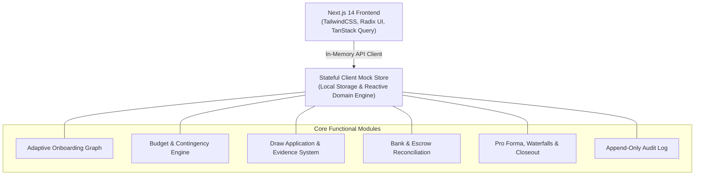

# GroundUp AI

> **Financial Control Center & Construction Intelligence Platform for Real Estate Developers, General Contractors, and Equity Lenders.**

GroundUp AI bridges the trust gap between Developers, General Contractors (GCs), Project Managers (PMs), CFOs, and Equity Investors. It offers automated budget control, adaptive multi-role onboarding, draw package verification, loan payoff tracking, real-time transaction reconciliation, and investor waterfall distribution modeling.

---

## Architecture Overview

GroundUp AI is designed as a high-performance, standalone Next.js application running completely in the browser without any backend or Docker dependencies. It features a reactive, in-memory stateful data store with localStorage persistence, providing complete domain capabilities, instant mutations, and rich realistic real-estate development data.



### Tech Stack
- **Frontend**: Next.js 14 (App Router), React 18, TypeScript, TailwindCSS, Radix UI primitives, Lucide Icons, Recharts, Vitest & Playwright.
- **Data Engine**: Reactive client-side mock repository with complete entity schemas and offline data persistence. Zero backend or Docker required.

---

## Key Modules & Platform Features

1. **Adaptive Multi-Role Onboarding & Decision Graph**
   - Role-customized onboarding paths for `OWNER`, `CFO`, `PM`, `GC`, and `INVESTOR`.
   - Dynamic questionnaire graph adapting questions based on role, responses, and risk criteria.
   - High-risk configuration tracking, duplicate project detection, and missing-information fallback task creation.

2. **Clean B2B SaaS Project Setup (Stage 3 Contract Models)**
   - Contract models supported: **Cost-Plus (Standard)**, **Guaranteed Maximum Price (GMP)**, **Fixed Price (Stipulated Sum)**, **Milestone-Based**, **Open-Book / Target Price**, and **Hybrid / Custom**.
   - Dedicated Project Account vs. Shared Operating Account with Virtual Sub-Ledger.

3. **Budget & Contingency Management**
   - Baseline budget locking with audit-logged Change Order Requests (COR).
   - Real-time contingency pool reallocation and overrun monitoring.

4. **Applications for Payment & Draw Management**
   - Submissions by General Contractors with supporting cost evidence, invoices, and unconditional lien waivers.
   - Owner/CFO draw approval workflows with lender draw request packaging and shortfall tracking.

5. **Reconciliation & Anomaly Detection**
   - Bank/Escrow statement import and multi-factor transaction matching.
   - Quarantine resolution for missing invoices, suspicious payees, and unallocated transactions.

6. **Economics, Pro Forma & Investor Waterfall**
   - Equity contributions, unit disposition tracking, loan payoff, and distribution waterfall calculations.
   - Redacted investor portal views and exportable monthly snapshot packages.

---

## Quick Start (Zero Dependencies)

### Prerequisites
- **Node.js 18+ & npm**

### Run Development Server
```bash
# Install dependencies
npm install

# Start the dev server
npm run dev
```

Visit [http://localhost:3000](http://localhost:3000) in your browser.

---

## Seeded Persona Accounts

All demo accounts use the standard password `Password123!`, or you can use the interactive **Floating Demo Button** on the login screen to sign in with one click:

| Role | Persona | Email | Purpose / View |
| :--- | :--- | :--- | :--- |
| **OWNER** | Marcus Vance | `m.vance@vancedev.com` | Complete executive oversight, contingency moves, draws & investor updates |
| **CFO** | Sarah Lin | `s.lin@vancedev.com` | Bank reconciliations, invoice matching, capital stack & draws |
| **PM** | David Ross | `d.ross@vancedev.com` | Schedule milestones, field progress inspection, discrepancy resolution |
| **GC** | Frank Miller | `frank@apexconstruction.com` | Pay applications, cost evidence, change order requests (COR) |
| **INVESTOR** | Elena Rostova | `e.rostova@meridiancap.com` | High-level KPI dashboards, published investor updates & returns |
| **OWNER / MULTI** | Kunal Shah | `kunal@builderscapital.com` | Project isolation test persona (Owner on 73 Broadway, CFO on 392 First St) |

---

## Testing & Quality Assurance

### Run Unit Tests
```bash
npm run test
```

### Run Playwright End-to-End Tests
```bash
npm run test:e2e
```

### Run TypeScript & Lint Checks
```bash
npm run type-check
npm run lint
```
